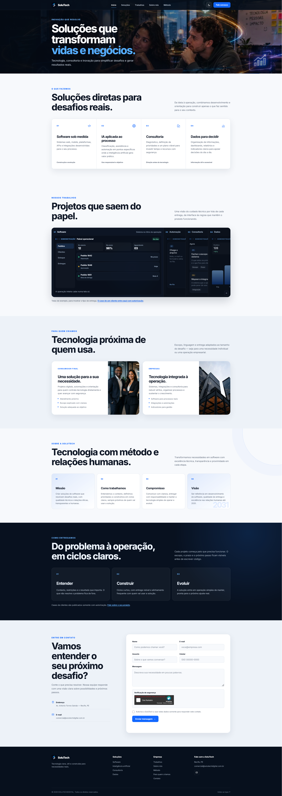

# SoluTech
Sete cabeças, muita vontade de aprender e criar, e um objetivo em comum: transformar ideias em soluções usando tecnologia
Site institucional da [SoluTech](https://solutechdigital.com.br) — tecnologia que resolve.

## Stack Tecnológica
Site Institucional

  
  
  

## Missão e visão

**Missão.** Criar soluções de software que resolvam desafios reais, com qualidade técnica e relações éticas, transparentes e humanas.

**Visão.** Ser referência em desenvolvimento de software, qualidade de entrega e excelência nas relações humanas até 2031.

**Como trabalhamos.** Entendemos o contexto, definimos prioridades e construímos em ciclos claros, sempre próximos de quem vai usar a solução.

**Compromisso.** Comunicar com clareza, entregar com responsabilidade e manter a tecnologia simples de operar e evoluir.

## O que fazemos

- **Software sob medida.** Sistemas web, mobile, plataformas, APIs e integrações feitas para o processo de quem contrata.
- **IA aplicada ao processo.** Classificação, assistência e automação nos pontos em que a inteligência artificial tem uso prático.
- **Consultoria.** Diagnóstico, prioridades e um plano viável antes de investir tempo e recurso em tecnologia.
- **Dados para decidir.** Informação organizada, dashboards, relatórios e indicadores claros para o dia a dia.

## Para quem

- **Pessoas** que contratam tecnologia diretamente e precisam de atendimento próximo, escopo explicado e uma solução no tamanho do objetivo.
- **Empresas** que precisam de software integrado à operação: processos reais, automações e indicadores para sustentar o crescimento.

## Como o site foi feito

Uma página só, dividida nas mesmas ideias da empresa: início, soluções, públicos, sobre, cases e contato.

| Arquivo | Função |
| --- | --- |
| `index.html` | Página: texto, seções e metadados |
| `404.html` | Resposta quando o endereço não existe |
| `css/style.css` | Visual, layout responsivo e temas claro e escuro |
| `js/theme-init.js` | Aplica o tema salvo antes da primeira pintura |
| `js/script.js` | Menu, troca de tema, slides de trabalhos e formulário |
| `img/` | Logo, banner e imagens dos públicos |
| `robots.txt` | Permissão de rastreamento e endereço do sitemap |
| `sitemap.xml` | Mapa do site para os buscadores |
| `.htaccess` | HTTPS, cache e cabeçalhos de segurança no Apache |

O formulário de contato envia a mensagem pelo [Web3Forms](https://web3forms.com), com verificação hCaptcha. A escolha de tema fica salva no navegador.

## Onde encontrar a SoluTech

- Site: [solutechdigital.com.br](https://solutechdigital.com.br)
- E-mail: [comercial@solutechdigital.com.br](mailto:comercial@solutechdigital.com.br)
